<div align="center">


</div>

&nbsp;

## The Pitch

Python. Linux. Packaging. Scripts that save you an hour.
Nobody had a Linux build, so I made one and put it on six package formats.
I use Arch, btw.

## The Stack


## The Main Move rn: [HaramMute-Linux](https://github.com/AS-Offical/HaramMute-Linux)

Linux build of the local server behind the HaramMute browser extension. Unofficial, no ties to the Windows devs.

```bash
curl -fsSL https://raw.githubusercontent.com/AS-Offical/HaramMute-Linux/main/install-release.sh | bash
```

The installer checks the file, picks the package for your distro, and installs it.

| distro | package |
|---|---|
| Debian / Ubuntu | `.deb` |
| Fedora 44 | `.rpm` |
| openSUSE Tumbleweed | `.rpm` |
| Arch | `.pkg.tar.zst` |
| NixOS | flake + package |
| any other glibc distro | AppImage |

91 commits. CI on the packages. Docs in Arabic and English. MIT.
x86_64 and CPU only, no ARM, no Alpine. It's all in the README.

[](https://github.com/AS-Offical/HaramMute-Linux/actions/workflows/linux-package-checks.yml)
[](https://github.com/AS-Offical/HaramMute-Linux/releases/latest)


## After Dark


